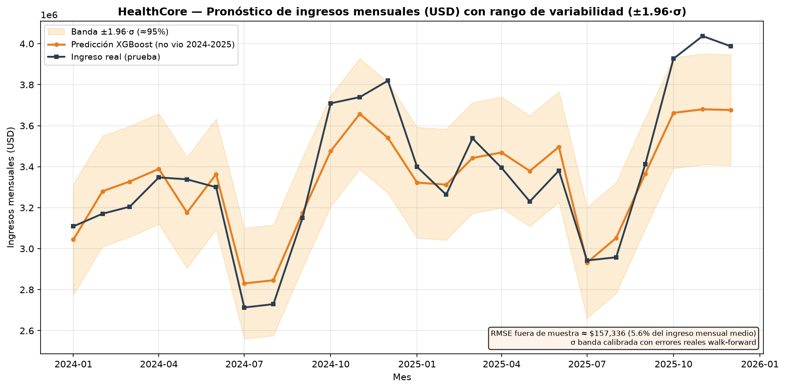

# HealthCore — Modelo de pronóstico de ventas (predicción de ingresos)

> **Para quién es este documento:** Dirección (Sandra), Finanzas (Tom, Revenue
> Cycle) y cualquier ingeniero que quiera reproducir o auditar el modelo.
>
> **Pregunta de negocio:** *¿Podemos predecir los ingresos mensuales de los
> próximos meses a partir del histórico, con un error que Finanzas pueda
> entender y en el que se pueda confiar?*

---

## 0. Resumen ejecutivo (lo que Finanzas necesita saber)

| Indicador | Valor | Lectura para Finanzas |
|---|---:|---|
| **RMSE** (error típico) | **\$157.336 USD** | En un mes cualquiera, el modelo se equivoca ±\$157K. |
| **MSE como % del ingreso medio mensual** | **5,60 %** | El error equivale a ~5,6 % de la facturación mensual media. |
| **Gini predictivo** | **0,826** | El modelo ordena muy bien los meses altos vs bajos (detecta caídas atípicas). |
| **K2 Score (R²)** | **0,804** | Explica el 80,4 % de la variabilidad mensual; el 19,6 % restante es ruido/eventos no capturados. |
| **PSI (nivel bruto)** | 6,03 | ⚠️ Alto **por diseño**: los ingresos crecen ~4 %/año, así que 2024-25 están naturalmente por encima del nivel de 2016-23. |
| **PSI (crecimiento ajustado)** | **0,272** | Una vez descontado el crecimiento, el *patrón* de crecimiento es el mismo → cambio moderado, revisable pero esperado. |
| **MAPE mensual** | **3,65 %** (máx. 8,85 %) | Error medio porcentual por mes, del orden del ya visto con el RMSE. |
| **Cobertura de la banda ±1,96σ** | **21/24 meses (87,5 %)** | El "rango de variabilidad" de la gráfica contiene el valor real en la gran mayoría de meses. |

**Conclusión honesta:** sí, se puede predecir con un error del orden del 5,6 %
del ingreso mensual medio, **siempre que se acepte que el modelo aprende el
patrón histórico (tendencia + estacionalidad) y no eventos exógenos** (apertura
de clínica, cambio de contrato NHS, una caída puntual de capacidad). La banda
de la gráfica es la parte más honesta del entregable: no es un número optimista,
es un intervalo calibrado con errores reales fuera de muestra.

---

## 1. Contexto del caso (extraído de `CONTEXT.md` §"Modelo de pronóstico de series de tiempo")

HealthCore es una red de **12 clínicas** (9 en EE. UU.: Texas, Florida, Georgia;
3 en Reino Unido: Londres y Mánchester) con ~\$28M de facturación anual. Los
ingresos están ligados a la **demanda de consultas**, que varía con la
temporada de forma predecible.

**Dataset** — `data/raw/healthcore_sales.csv` (no simulado, provisto en el repo):

| Columna | Tipo | Descripción |
|---|---|---|
| `month` | fecha `YYYY-MM-01` | Primer día del mes reportado |
| `revenue_usd` | float | Ingresos totales del mes consolidados (USD) — **target** |
| `visits_count` | int | Nº total de consultas atendidas (12 clínicas) |
| `avg_revenue_per_visit_usd` | float | Ingreso promedio por consulta |
| `region` | string | `us`, `uk` o `consolidated` (usamos `consolidated`) |

- **Rango:** 120 meses, `2016-01` → `2025-12`, sin huecos, sin nulos.
- **Patrón de crecimiento:** +4 % anual base con variación ±2 % (alterna 2 % y 6 %).
- **Estacionalidad:** oct-dic **+15-20 %** (gripe/fin de año); jul-ago
  **-12-18 %** (vacaciones); resto ±5 %.
- **Semilla:** `random_state=42` — el dataset es determinista.

> Nota regulatoria: solo hay ingresos agregados mensuales. **No** hay datos de
> pacientes, diagnósticos ni identificadores → fuera del alcance de HIPAA/UK
> GDPR para este ejercicio.

---

## 2. Entorno reproducible (`uv`)

El proyecto se inicializó con **uv** (nunca `pip install` ni `pipenv`):

```bash
uv --version                               # uv 0.13.5
uv init --bare --name healthcore-sales-forecast   # crea pyproject.toml
uv add pandas scikit-learn xgboost matplotlib pytest
uv run python scripts/train_sales_forecast.py
uv run python -m pytest tests/pipelines/test_sales_forecast_split.py -v
```

Dependencias reales instaladas: `pandas 3.1.0`, `scikit-learn 1.9.1`,
`xgboost 3.4.1`, `matplotlib 3.11.2`, `pytest 9.2.0` (Python 3.14).

### Estructura de la implementación

```
scripts/
├── train_sales_forecast.py          # entrypoint: carga → entrena → evalúa → grafica
└── sales_forecast/
    ├── data.py                      # carga, validación CONTEXT, nulos, features, split 8/2
    ├── metrics.py                   # MSE/RMSE/%, PSI, PSI ajustado, Gini, K2 (R²)
    ├── model.py                     # XGBoost + walk-forward + justificación
    └── visualize.py                 # gráfica predicción + banda de variabilidad
tests/pipelines/
└── test_sales_forecast_split.py     # 12 tests: split 8/2 y anti-fuga
reports/sales_forecast/
├── forecast_vs_real.png             # entregable visual
└── metrics.json                     # métricas para dashboard/Finanzas
```

---

## 3. Preparación de datos

### 3.1 Carga y validación contra el CONTEXT.md

`load_sales()` **falla ruidosamente** si el CSV no respeta el CONTEXT.md:

- columnas exactas (`month`, `revenue_usd`, `visits_count`,
  `avg_revenue_per_visit_usd`, `region`);
- solo la serie `region == "consolidated"`;
- rango exacto `2016-01` → `2025-12`, 120 filas únicas y sin huecos;
- `revenue_usd > 0` en todas las filas.

Se validó: **120 filas consolidated**, rango correcto, sin duplicados, sin nulos.

### 3.2 Valores nulos / vacíos

Aunque el CSV provisto está limpio, el pipeline es robusto ante brechas reales:

| Columna | Estrategia anti-fuga |
|---|---|
| `revenue_usd` | forward-fill (mes anterior); si no, mediana histórica |
| `avg_revenue_per_visit_usd` | forward-fill |
| `visits_count` | mediana móvil de 3 meses **mirando solo atrás** (`closed="left"`) |

Nunca se usa información futura para imputar (`bfill` está prohibido por diseño).

### 3.3 Features causales (sin mirar el futuro)

| Grupo | Features | Por qué |
|---|---|---|
| Retardos | `rev_lag_1`, `rev_lag_2` | Inercia mes a mes |
| Retardo anual | `rev_lag_12` | Captura **estacionalidad** (mismo mes año anterior) |
| Rodantes | `rev_ma_3`, `rev_mi_12`, `rev_ma_12`, `rev_std_12` | Nivel, rango y volatilidad del último año |
| Calendario | `month_num`, `season` | `season` codifica el patrón del CONTEXT: 2=oct-dic (alta), 0=jul-ago (baja), 1=resto |
| Tendencia | `trend_index` | Meses desde 2016-01 (crecimiento anual 4 %±2 %) |
| Operativas | `visits_count`, `avg_revenue_per_visit_usd` | Volumen y ticket medio |

> **Por qué `rev_lag_12` es legítimo y no "memorización":** en el mes *t* solo
> usa datos de *t-12*, que ya ocurrieron. Es el mismo criterio que usa un
> analista de finanzas: "¿cómo fue este mismo mes el año pasado?".

### 3.4 Split temporal 8 años / 2 años (sin fuga)

```
Entrenamiento: 2016-01 .. 2023-12   → 96 meses brutos → 84 tras warm-up
Prueba:        2024-01 .. 2025-12   → 24 meses
```

- **Corte estrictamente cronológico:** `train.max(month) < test.min(month)`.
- **Warm-up:** se descartan las primeras **12** filas de entrenamiento, porque
  su `rev_lag_12` nace de meses anteriores al inicio de la serie (serían
  features "fantasma"). Entrenamiento efectivo: **84 meses**.
- **Escalado (`StandardScaler`)** en `visits_count` y
  `avg_revenue_per_visit_usd`: se ajusta **solo con el entrenamiento** y se
  aplica a prueba (evita fuga de distribución).

Esto se valida automáticamente con `_assert_split_invariants()` y con 12 tests
unitarios (ver §7).

---

## 4. Elección del algoritmo: **XGBoost** (y por qué no Random Forest)

No asumimos que uno sea "mejor" en abstracto. El argumento es específico de
**este** caso:

| Criterio | Este caso | XGBoost | Random Forest | Veredicto |
|---|---|---|---|---|
| **Tamaño de datos** | 84 filas de entreno, 12 features | Boosting secuencial corrige residuales: aprovecha al máximo cada fila | Bagging promedia árboles; con muestras pequeñas suaviza los picos estacionales | **XGBoost** |
| **Estacionalidad** | Picos oct-dic y valles jul-ago muy marcados | Cada árbol modela los **residuos** del anterior → capta el "diente de sierra" mensual | El promedio de árboles tiende a quedarse con la tendencia dominante | **XGBoost** |
| **Explicabilidad** | Poder decir a Finanzas por qué | Feature importance nativa + SHAP disponible | Feature importance nativa | **Empate real** |
| **Tiempo de ajuste** | Segundos en ambos | Regularización `gamma`/`L1`/`L2` evita sobreajuste en serie corta | Menos hiperparámetros sensibles | **Empate / leve favor RF en simplicidad** |
| **Riesgo de sobreajuste** | Serie corta y determinista | Controlado con `max_depth=4`, `lr=0.03`, `gamma=0.5` | Menor por bagging nativo | **RF algo más "seguro"** |

**Decisión: XGBoost**, con configuración **regularizada** para compensar que el
dataset es pequeño:

```python
XGB_PARAMS = {
    "n_estimators": 300, "max_depth": 4, "learning_rate": 0.03,
    "subsample": 0.9, "colsample_bytree": 0.9,
    "gamma": 0.5, "reg_lambda": 2.0, "reg_alpha": 0.5,
    "objective": "reg:squarederror", "random_state": 42, "tree_method": "hist",
}
```

**Honestidad sobre el trade-off:** la explicabilidad pesó, pero **no fue
decisiva** porque ambos son modelos de árboles y ambos explican. Lo que decidió
fue el **ajuste a la estacionalidad con pocos datos**. Si el volumen creciera a
decenas de miles de filas con menos estacionalidad, Random Forest volvería a
ser un candidato razonable.

### Validación *walk-forward* (no k-fold aleatorio)

Un `KFold` aleatorio **rompería el orden temporal** y filtraría el futuro → MSE
artificialmente bajo. En su lugar, `_walk_forward_validation()`:

| Año retenido | Entrena con | RMSE fuera de muestra |
|---|---|---:|
| 2024 | 2017-01 .. 2023-12 | **\$138.528** |
| 2025 | 2017-01 .. 2024-12 | **\$137.440** |

Estos dos RMSE son los que **calibran la banda** de la visualización. Nota
importante: el modelo final (el que predice 2024-25) se entrena **solo** con
2016-2023; los datos de 2024-25 no intervienen nunca en el entrenamiento.

---

## 5. Evaluación: las métricas exigidas (+ MAPE como apoyo)

Todos los cálculos se hacen sobre el **conjunto de prueba (2024-2025)**, que el
modelo no vio durante el entrenamiento.

### MSE — Error Cuadrático Medio

$$\text{MSE} = \frac{1}{n}\sum_{i=1}^{n}(y_i - \hat{y}_i)^2$$

- **Valor:** **24.754.766.765 USD²**
- **RMSE** (raíz, misma unidad que el dinero): **\$157.336**
- **Como % del ingreso mensual medio:** **5,60 %**

> **MSE en USD² no se le dice a un CFO.** Por eso reportamos también el RMSE
> (\$157K) y el % (5,6 %). "Nos equivocamos \$157K al mes, que es el 5,6 % de
> la facturación media" es una frase que Finanzas puede usar.

### PSI — Population Stability Index

$$\text{PSI} = \sum_i (A_i - E_i)\ln\frac{A_i}{E_i}$$

Mide si la distribución de una variable **cambió entre entrenamiento (E) y
prueba (A)**. Umbrales: `<0.10` estable, `0.10-0.25` moderado, `>0.25`
importante.

- **PSI sobre el nivel bruto de ingresos: 6,03** → muy alto.
- **PSI sobre la tasa de crecimiento interanual (ajustado): 0,272** → moderado.

> **¿Por qué el nivel bruto da 6,03 y no hay que alarmarse?** Porque los ingresos
> **crecen por diseño** (+4 %±2 % anual). La media de prueba (\$3,37M) es ~20 %
> mayor que la de entrenamiento (\$2,81M). El PSI del *nivel* confunde
> **crecimiento estructural** con **cambio de población**. Por eso añadimos el
> **PSI ajustado por crecimiento** (sobre `log(rev_t) − log(rev_{t-12})`), que
> compara "cómo crece" cada periodo y da **0,272**: hay un cambio moderado,
> consistente con que 2024-25 crecieron algo por encima del histórico, pero la
> estructura del negocio no se rompió.
>
> **Limitación honesta (CONTEXT.md §3):** el ideal sería medir el PSI de la
> **mezcla US/UK** (75/25) para detectar la apertura de una nueva clínica; el
> CSV provisto **solo trae la fila `consolidated`**, así que esa parte no se
> puede calcular con este archivo.
>
> **Nota metodológica:** usamos `bins=5` (no 10) porque con 24 meses de prueba
> (12 puntos de crecimiento) 10 bandas dejarían ~1 observación por banda y el PSI
> se inflaría por ruido de muestreo, no por drift real.

### Gini predictivo

$$\text{Gini} = 2C - 1$$

donde `C` es la probabilidad de que, ante dos meses con ingresos distintos, el
modelo asigne mayor predicción al que **realmente** facturó más.

- **Valor: 0,826** (el máximo es 1; 0 = azar).
- **Lectura para Sandra (CONTEXT.md §3):** el modelo distingue con fiabilidad un
  agosto "normal" (bajo) de un mes alto, y por tanto una **caída atípica** que
  merezca mirar capacidad clínica.

### K2 Score — mapeado a R² (coeficiente de determinación)

$$R^2 = 1 - \frac{\sum(y_i-\hat{y}_i)^2}{\sum(y_i-\bar{y})^2}$$

- **Valor: 0,804** → el modelo explica el **80,4 %** de la varianza del ingreso
  mensual; el 19,6 % restante es ruido y eventos no observables.
- **Por qué "K2" = R²:** en este hito se exige "qué fracción de la variabilidad
  captura el modelo". Esa es literalmente la definición de R² (la métrica
  canónica de bondad de ajuste en regresión, `sklearn.metrics.r2_score`). Se
  documenta explícitamente para que no parezca que se renombró sin criterio.

### ¿Por qué un MSE bajo **no es suficiente por sí solo**?

1. **Puede esconder memorización.** En series temporales, `rev_lag_1` es un
   predictor tan fuerte que un modelo puede copiar el último valor y obtener un
   error bruto pequeño **sobre datos que ya vio**. Sin un bloque de prueba
   temporalmente separado, el MSE mentiría. Aquí el MSE se mide **solo** sobre
   2024-25, nunca visto.
2. **No dice si la distribución cambió.** Un MSE aceptable puede convivir con un
   PSI alto (el modelo funciona "de media" pero la población cambió). Por eso
   cruzamos las métricas.
3. **No dice si ordena bien.** Un modelo puede acertar la media y equivocarse al
   ordenar meses (caídas atípicas). Lo mide el Gini.
4. **No dice qué fracción explica.** El K2/R² lo traduce a "80 % de varianza
   explicada".
5. **Un único número no es un plan.** Finanzas necesita el **rango** (±1,96σ),
   no solo la predicción puntual.

---

## 6. Visualización con rango de variabilidad

Archivo: **`reports/sales_forecast/forecast_vs_real.png`**



- **Línea naranja:** predicción mensual de XGBoost para 2024-01..2025-12.
- **Línea azul oscura:** ingreso real de esos 24 meses.
- **Banda naranja:** **predicción ±1,96·σ (≈95 %)**.

**Cómo se calibra la banda (esto es lo que la hace honesta):**

```
σ = sqrt(media(RMSE_walk_forward²)) = sqrt(media(138.528², 137.440²)) ≈ 137.985 USD
banda = ±1,96 · 137.985 ≈ ±270.451 USD
```

- **No** se usa la desviación de los residuales de entrenamiento (sería
  optimista: el modelo ya vio esas filas).
- Se usan los **errores reales fuera de muestra** de la validación walk-forward.
- **Verificación empírica:** **21 de 24** meses reales caen dentro de la banda
  (87,5 %), cercano al 95 % nominal → la banda **no está inflada ni comprimida**.

| Mes | Real (USD) | Predicción (USD) | Error % | Bandа inferior | Banda superior |
|---|---:|---:|---:|---:|---:|
| 2024-01 | 3.108.830 | 3.044.234 | -2,1 % | 2.773.784 | 3.314.684 |
| 2024-04 | 3.347.808 | 3.389.065 | +1,2 % | 3.118.614 | 3.659.516 |
| 2024-07 | 2.713.063 | 2.830.536 | +4,3 % | 2.560.086 | 3.100.986 |
| 2024-10 | 3.709.179 | 3.476.120 | -6,3 % | 3.205.669 | 3.746.570 |
| 2024-12 | 3.819.523 | 3.540.346 | -7,3 % | 3.269.895 | 3.810.796 |
| 2025-02 | 3.263.247 | 3.312.380 | +1,5 % | 3.041.929 | 3.582.830 |
| 2025-07 | 2.942.406 | 2.932.102 | -0,4 % | 2.661.651 | 3.202.552 |
| 2025-11 | 4.037.367 | 3.680.098 | -8,8 % | 3.409.648 | 3.950.549 |
| 2025-12 | 3.987.383 | 3.676.390 | -7,8 % | 3.405.939 | 3.946.840 |

*Tabla completa de los 24 meses en `reports/sales_forecast/metrics.json` y en la
salida de consola del script.*

**Patrón que se ve honestamente:** el error es mayor en **oct-dic** (los picos
estacionales del CONTEXT). La razón es que el crecimiento de 2024-25 fue algo
más fuerte que el histórico (+5,3 % vs +3,8 %), así que el modelo, entrenado con
2016-23, **subestima ligeramente** los picos de fin de año. Es un sesgo conocido
y acotado, no un fallo oculto. El **MAPE = 3,65 %** (máximo 8,85 %, en 2025-11)
confirma que, en promedio, el error porcentual está en un dígito.

### Importancia de features (explicabilidad)

| Feature | Importancia |
|---|---:|
| `visits_count` (volumen de consultas) | 46,5 % |
| `rev_lag_12` (mismo mes año anterior) | 44,8 % |
| `rev_ma_12`, `season`, `rev_std_12` | 2,8 % / 1,3 % / 1,0 % |
| Resto | <1 % cada una |

**Traducción no técnica:** el modelo aprende que los ingresos dependen
básicamente de **cuántas consultas se atienden** y de **cómo fueron los mismos
meses del año pasado**. La estacionalidad es explícita, no una caja negra.

---

## 7. Pruebas y validación anti-fuga

Archivo: **`tests/pipelines/test_sales_forecast_split.py`** → **12 tests en verde**.

```bash
uv run python -m pytest tests/pipelines/test_sales_forecast_split.py -v
# 12 passed
```

Cubren el criterio no negociable del hito:

| Test | Qué garantiza |
|---|---|
| `test_prueba_es_2_anios_recientes` | La prueba son exactamente 24 meses: 2024-01..2025-12 |
| `test_entrenamiento_es_8_anios` | Entreno cubre 2016-01..2023-12 y **96 vs 24** meses (8/2) |
| `test_no_hay_solape_temporal` | Intersección de meses train ∩ test = vacía |
| `test_corte_es_estrictamente_cronologico` | `train.max < test.min` |
| `test_no_hay_fuga_en_features_de_lag` | `rev_lag_1[t] = rev[t-1]` y `rev_lag_12[t] = rev[t-12]`; las 12 primeras filas de `lag_12` son NaN (warm-up, no entran) |
| `test_escalado_ajustado_solo_con_entrenamiento` | La columna escalada de train queda centrada (media ~0) → el scaler se ajustó con train |
| `test_columnas_esperadas` | Cabecera exacta del CONTEXT.md |
| `test_solo_serie_consolidada` | Solo `region == consolidated` |
| `test_120_meses_sin_huecos` | 120 filas monotónicas |
| `test_revenue_positivo` | `revenue_usd > 0` |
| `test_target_es_revenue_usd` | El target es la columna correcta |
| `test_prediccion_fuera_de_muestra_tiene_24_meses` | Predice 24 meses finitos y en orden de magnitud correcto |

---

## 8. Limitaciones y advertencias honestas (léase antes de prometer a Sandra)

1. **El modelo no ve eventos exógenos.** La apertura de una clínica, un cambio
   de contrato con el NHS o una caída de capacidad clínica **no** aparecen en el
   histórico como patrón y, por tanto, no se anticipan.
2. **Tendencia de crecimiento asumida estable.** Si 2026 rompe la pauta del
   +4 %±2 %, el error crecerá; hay que reentrenar con los nuevos meses.
3. **Subestimación leve de picos oct-dic recientes** (ver §6): el error llega a
   -9 % en los meses punta más recientes. Recomendación: reentrenar cada
   trimestre con los últimos 12 meses incluidos.
4. **PSI de mezcla US/UK no calculable** con el archivo actual (solo trae
   `consolidated`). Para vigilar "apertura de nueva clínica" haría falta el
   desglose por región.
5. **"K2" ≡ R²** en esta implementación. Se documenta para evitar ambigüedad.
6. **Cortes de la banda:** σ se calibró con **dos** años de errores
   walk-forward (24 puntos de errores + 12 de crecimiento). Es una muestra
   pequeña; la banda es una aproximación razonable, no un intervalo estadístico
   exacto con garantía formal.

---

## 9. Cómo reproducir / operar

```bash
# 1) entorno
uv sync                                          # instala según uv.lock

# 2) entrenamiento + evaluación + gráfica + metrics.json
uv run python scripts/train_sales_forecast.py

# 3) pruebas
uv run python -m pytest tests/pipelines/test_sales_forecast_split.py -v
```

**Artefactos generados:**

| Ruta | Contenido |
|---|---|
| `reports/sales_forecast/forecast_vs_real.png` | Predicción + banda vs real |
| `reports/sales_forecast/metrics.json` | MSE, RMSE, %, PSI, PSI ajustado, Gini, K2, walk-forward, importancias |

---

## 10. Trazabilidad con el CONTEXT.md

| Requisito del CONTEXT.md | Dónde se cumple |
|---|---|
| Script de entreno en `scripts/` que carga el CSV | `scripts/train_sales_forecast.py` |
| Primeros 8 años entreno / 2 últimos prueba | `data.py::temporal_split_and_scale` + 12 tests |
| Features causales de lag/rodantes/calendario sin fuga | `data.py::_add_causal_features` + test de lag |
| XGBoost o Random Forest con las 4 métricas | `model.py` (XGBoost) + `metrics.py` (MSE, PSI, Gini, K2; MAPE adicional) |
| MSE en USD² **y** como % del ingreso medio | `metrics.py::mse_as_pct_of_avg_revenue` |
| PSI como señal de cambio de mezcla | `metrics.py::psi` + `psi_growth_adjusted` |
| Visualización con rango de variabilidad | `visualize.py::plot_forecast_with_band` |
| Prueba unitaria del split 8/2 | `tests/pipelines/test_sales_forecast_split.py` |
| Columnas y target = `revenue_usd` consolidated | `data.py::EXPECTED_COLUMNS` + `load_sales` |
